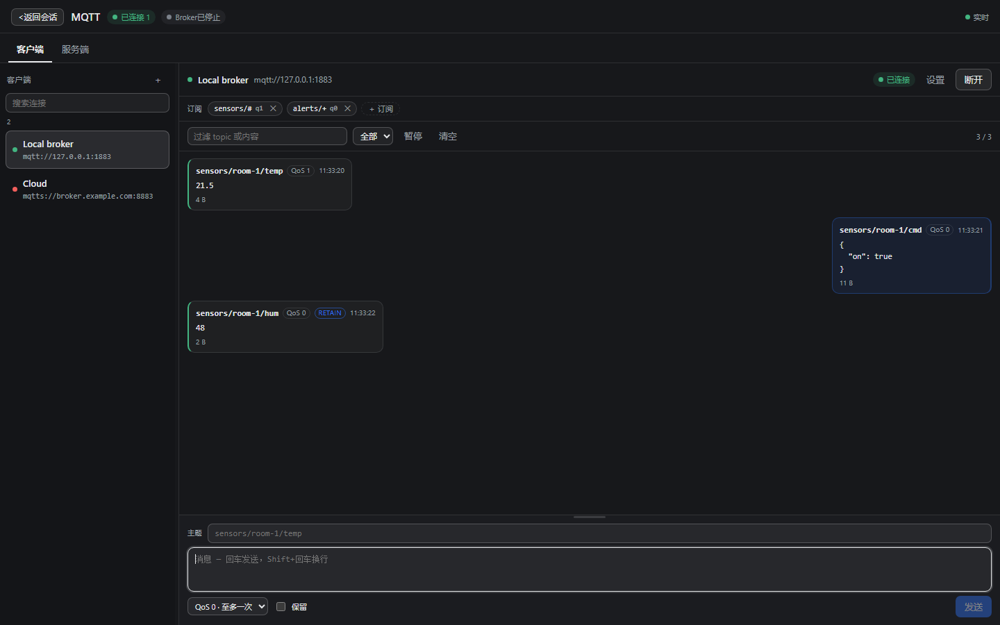
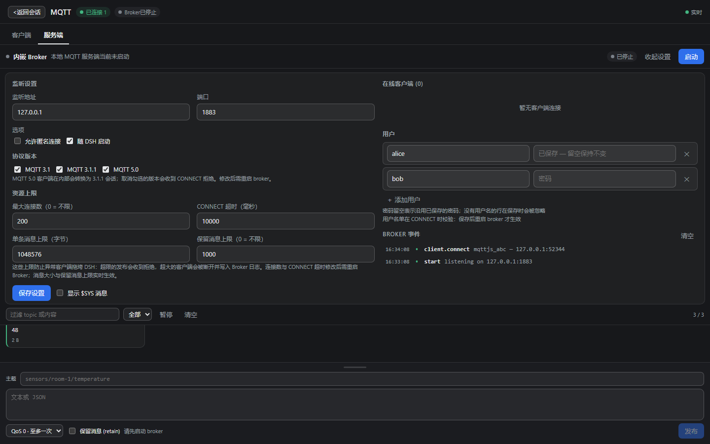
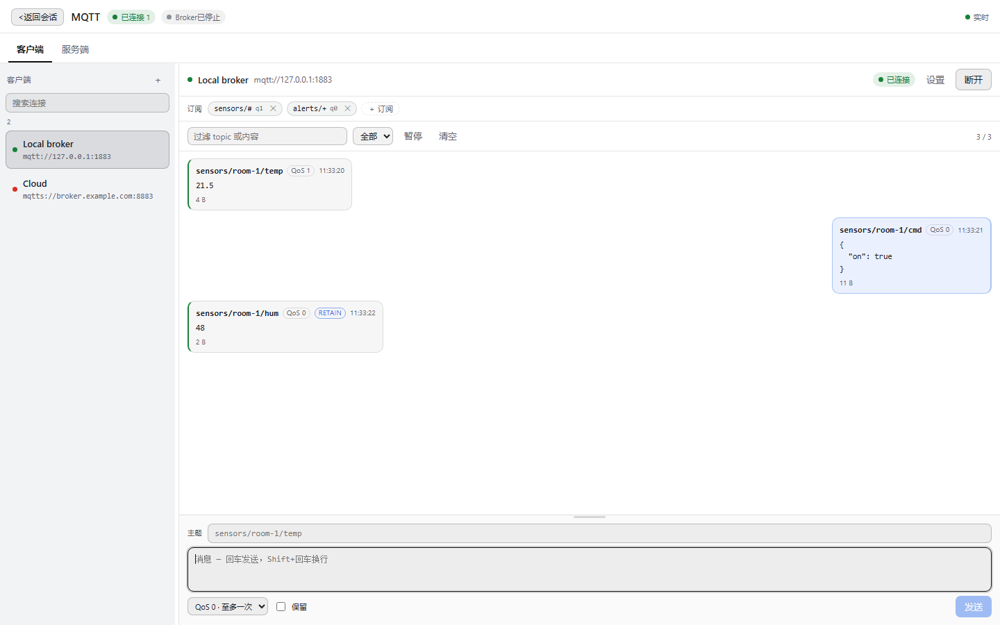

# dsh-mqtt-tools

[](https://github.com/GodLike2020/dsh-mqtt-tools/actions/workflows/ci.yml) [](https://www.npmjs.com/package/dsh-mqtt-tools) [](https://www.npmjs.com/package/dsh-mqtt-tools) [](https://github.com/deepseek-ai/deepseek-harness)

[简体中文](README.md) · **[English](README.en.md)**

An MQTT client **and** an embedded MQTT broker for [DeepSeek Harness](https://github.com/deepseek-ai/dsh), packed as one DSH plugin bundle.

Open the **MQTT** panel in the sidebar, connect to a broker (or start one on this machine), subscribe, publish, and watch messages flow — and give every agent in the harness nine `mqtt_*` tools for the same engine.



## Features

- **Two tabs, one panel**
  - **Clients** — saved connections, chat-style message log, persistent composer. One card: the topic line on top, the message box under it, send at the bottom right. Enter sends, Shift+Enter adds a newline (a composing IME never fires), and an empty topic puts the focus on the topic field. The box grows with the text and is resizable: drag the grip above it (or focus it and use ↑/↓), and the height you pick is remembered for the session. Edit a URL or a username and press connect: the draft is saved first, so the connection dials with what you see even if the settings are folded away. Retry after a failure or a drop works, and saving a new address while connected closes the old session first instead of publishing to the broker the card no longer names.
  - **Broker** — the embedded server, connected clients, event log, and the same send card as a client at the bottom. Its settings drawer folds too — a running broker starts folded so the log gets the room — and pressing start saves the current draft before starting. Its message box resizes the same way: drag the grip above it — or focus the grip and use the arrow keys — to make room for a long payload. Retained messages are saved with the configuration and replayed after a restart; the drawer shows how many topics retain a value and clears them all in one click.
- **Real MQTT client** — saved profiles (URL, client id, credentials, keepalive,
  clean session, reconnect period, protocol 3.1 / 3.1.1 / 5.0), subscribe /
  unsubscribe with QoS, publish with QoS 0–2 and retain, wildcard topics,
  retained messages, reconnects.
- **Embedded broker** — start it from the panel: host, port, anonymous access or
  a user table, auto-start with DSH, protocol versions 3.1 / 3.1.1 / 5.0,
  retained messages, persistent sessions, `$SYS` toggle, per-client
  subscriptions, event log.
- **Message log** — direction arrows, topic, payload (UTF-8 or base64), QoS,
  retain flag, timestamps, newest-page paging, filter box, pause.
- **Agent tools** — the same engine the panel uses, exposed to any agent:
  `mqtt_list`, `mqtt_connect`, `mqtt_disconnect`, `mqtt_subscribe`,
  `mqtt_unsubscribe`, `mqtt_publish`, `mqtt_messages`, `mqtt_wait`,
  `mqtt_broker`.
- **Light and dark** — surfaces are derived from the current text colour, so the
  panel stays readable with monochrome themes as well.

| Broker tab | Clients, light theme |
| --- | --- |
|  |  |

## Install

The plugin is a DSH bundle: it ships `package.json` with a `dsh.bundle.patch`,
a host half (`index.js` + `lib/`) and a browser half (`client.js`). Published on
npm as [`dsh-mqtt-tools`](https://www.npmjs.com/package/dsh-mqtt-tools).

### From npm (recommended)

```powershell
# 1. let DSH fetch the bundle from npm (plugin_manager → install_bundle → target: dsh-mqtt-tools)
plugin_manager install_bundle { "target": "dsh-mqtt-tools" }

# 2. enable the "MQTT Tools" bundle when DSH lists it
```

### From a source checkout

```powershell
git clone https://github.com/GodLike2020/dsh-mqtt-tools.git
cd dsh-mqtt-tools
npm install
# then: Settings → Plugins → Install bundle → target: this folder
# (or: plugin_manager → install_bundle → target: <absolute path>)
```

If you manage your profile's dependencies by hand, `dsh plugin add dsh-mqtt-tools`
works too.

Restart/reload DSH once after installing; the **MQTT** entry appears in the
sidebar. No configuration is required — the panel starts empty.

> The plugin never edits your profile's `package.json` or `cordis.patch.yml` by
> hand: bundle installation and patching go through DSH's own installer.

## Compatibility note: known issue on DSH ≤ 0.2.2-alpha.2

DSH's profile resolver has a bug: when a plugin's dependency tree contains a request
such as `require('<builtin-name>/')` — the trailing-slash form used by polyfill-era
packages — the resolver crashes, and the plugin fails to load with only a generic
`failed to import` line in the host log. `readable-stream` 4.x does this
(`require('process/')`), and `dsh-mqtt-tools` depends on `mqtt` → `readable-stream@4.x`.

Since 0.3.13 the plugin ships a **transitional workaround**: at startup it synchronously
preloads `readable-stream` in the native Node stream mode (`READABLE_STREAM=disable`),
so the offending request never happens. It is harmless on fixed DSH versions — if your
DSH already has the fix, there is nothing to do — and will be removed once the host fix
is widely available.

- Affected: DSH `0.1.7-rc.2` … `0.2.2-alpha.2` (including desktop `0.2.1-rc.5`); the
  symptom is `TypeError: createRequire.resolve.paths is not a function or its return value is not iterable`
- Unaffected: plugins without `readable-stream@4.x` in their tree; fixed DSH builds
- This workaround covers the `readable-stream` family only; `punycode/`, `buffer/index`
  and similar cases still require the host fix.

## Using the panel

1. **Clients → New connection**: give it a name and a URL such as
   `mqtt://127.0.0.1:1883` or `mqtts://broker.example.com:8883` (TLS uses Node's
   default certificate store; `rejectUnauthorized` can be turned off per
   connection for self-signed brokers), plus optional username/password,
   client id, keepalive and protocol version.
2. **Connect**, then add subscriptions (`sensors/+/temperature`, `#`, …).
3. Type a topic and a message in the composer at the bottom and press Enter —
   messages arrive above it, newest at the bottom.
4. **Broker → Start** to run a local MQTT server. Point other devices or
   clients at `mqtt://<this machine>:1883`. If anonymous access is off, add
   users in the same tab and check the credentials in the connect form.

The window is resizable: drag the divider between the connection list and the
message area. Per-connection settings collapse to leave more room for messages.

## Agent tools

Every tool talks to the same engine as the panel, so a connection configured in
the GUI is immediately usable by an agent, and vice versa.

| Tool | What it does |
| --- | --- |
| `mqtt_list` | List connections (id, name, URL, status, subscriptions) and broker state. |
| `mqtt_connect` | Connect a saved connection by id/name, or create-and-connect with a `url`. |
| `mqtt_disconnect` | Close a connection. |
| `mqtt_subscribe` | Subscribe a connection to a topic filter with a QoS (persisted). |
| `mqtt_unsubscribe` | Remove a subscription. |
| `mqtt_publish` | Publish through a connection or through the embedded broker. |
| `mqtt_messages` | Read recent messages, filtered by connection/source/direction/topic. |
| `mqtt_wait` | Wait for matching messages (like `mosquitto_sub`), with a lookback window. |
| `mqtt_broker` | Show, start, stop or save the embedded broker. |

A typical agent flow:

```text
mqtt_broker start
mqtt_connect url=mqtt://127.0.0.1:1883 name=local
mqtt_subscribe connection=local topic="sensors/#" qos=1
mqtt_wait    connection=local topic="sensors/#" timeoutMs=10000
mqtt_publish via=client connection=local topic="devices/lamp/set" payload="on" qos=1
```

Message payloads are returned as UTF-8 when they decode cleanly and as base64
otherwise; `encoding: "base64"` on `mqtt_publish` sends binary payloads.

## HTTP API

The panel is not privileged: it uses the same API any local tool can.

| Method | Path | Purpose |
| --- | --- | --- |
| `GET` | `/dsh-mqtt-tools/api/state` | Current state (connections, broker, tools, state file) + recent messages/events. |
| `POST` | `/dsh-mqtt-tools/api/command` | One command: `client.*`, `broker.*`, `settings.save`, `log.clear`. |
| `GET` | `/dsh-mqtt-tools/api/events` | Server-Sent Events: `state`, `message`, `broker-event`, `cleared`. |

`POST` requires the `x-dsh-mqtt-tools: 1` header and a same-origin request;
passwords are write-only (the API returns `hasPassword`, never the value).

## Protocol versions

- **MQTT 3.1.1** — the native protocol of the embedded broker (`aedes`).
- **MQTT 3.1** — accepted, with 3.1 framing.
- **MQTT 5.0** — accepted on the same port. A translation layer converts the
  MQTT 5 session to 3.1.1 internally and re-encodes replies as MQTT 5, so MQTT 5
  clients connect, subscribe, publish, use QoS 1/2, retained messages and
  persistent sessions. MQTT-5-only features (properties, shared subscriptions,
  topic aliases, flow control) are not advertised and not implemented — the
  broker behaves like an MQTT 3.1.1 broker from the client's point of view.
  Subscription options such as `noLocal` and `retainHandling` are accepted but
  ignored: a client may receive its own publishes and retained messages are sent
  on every matching subscribe.

Each version can be disabled in the Broker tab; a disabled version is refused
with a proper CONNACK (`0x84` for MQTT 5, return code 1 for 3.1/3.1.1) and the
refusal is written to the broker event log.

### Resource limits

The embedded broker keeps a misbehaving client from exhausting the host process:

| Setting | Default | Effect |
| --- | --- | --- |
| `maxConnections` | `200` (0 = unlimited) | Extra TCP connections are closed as soon as they arrive, with an event in the broker log. |
| `connectTimeoutMs` | `10000` | A socket that does not send a CONNECT in time is closed and logged. |
| `maxPayloadBytes` | `1048576` (1 MiB) | Larger client publishes (and wills) disconnect the client; the panel's publish form and `mqtt_publish` get a normal error instead. |
| `maxRetainedMessages` | `1000` (0 = unlimited) | A retained publish that would add a topic beyond the cap is refused; clearing a retained topic with an empty payload frees a slot. |

They are stored with the other broker settings and can be changed in the Broker
tab, with the `mqtt_broker save` agent tool or through
`POST /dsh-mqtt-tools/api/command`:

```jsonc
{ "cmd": "broker.save", "broker": { "maxPayloadBytes": 262144, "maxRetainedMessages": 200 } }
```

Restart the broker to make the listener-related settings apply where noted; the
payload/retained budgets are enforced live.

## Where state lives

`$DSH_HOME/dsh-mqtt-tools.json` (default `~/.dsh/dsh-mqtt-tools.json`): connection
profiles (passwords included, file permissions are your OS account's), broker
settings and the `$SYS` toggle. Upgrading from 0.2.x renames and adopts the old
`dsh-mqtt.json` automatically.

## Testing

The repository ships a self-contained suite (dev only, not part of the published
package):

```powershell
node scripts/suite/run-all.mjs              # all suites, sequential
node scripts/suite/run-all.mjs protocol     # filter by name
node scripts/suite/ui.test.mjs              # one suite
```

| Suite | Covers |
| --- | --- |
| `protocol` | MQTT 3.1 / 3.1.1 / 5.0, wills, persistent sessions, retained, wildcards, QoS, malformed input, version gating. |
| `interop` | Our broker against external clients; our client against public brokers and a real broker. |
| `api-tools` | HTTP contract, CSRF/origin/limits, security, all nine agent tools end to end. |
| `ui` | Server-side render of every panel state, jsdom interaction, i18n parity, contrast audit. |
| `lifecycle` | SSE/hub leaks, state durability, port conflicts, restart/dispose, reconnect. |
| `perf` | Throughput, ring-log bounds, large payloads, connection storms, SSE fan-out. |
| `hardening` | Payload previews stay bounded before they enter the ring; SSE backpressure drops stalled pages instead of buffering forever. |
| `resilience` | Start/stop races, awaitable dispose with port release, CONNECT timeout, connection/payload/retained caps, limit persistence. |

Suites isolate themselves with a temporary `DSH_HOME` and random ports; live
suites need a running DSH GUI and take `DSH_BASE` (for example
`$env:DSH_BASE="http://127.0.0.1:10570"`).

## Notes

- The embedded broker speaks plain MQTT over TCP; there is no WebSocket or TLS
  listener yet. Expose it on your LAN deliberately (and open the firewall port).
- A panel visual check can be rendered without a DSH GUI via
  `node scripts/preview-shot.mjs dark` (dev only; `npm install` brings the dev
  dependencies, a local `.testtools/` install works just as well).
- `$SYS/broker/...` traffic is hidden from the message log unless the toggle in
  the Broker tab is on.
- The plugin is English + Chinese, following the harness locale.

## License

MIT — see [LICENSE](LICENSE).
