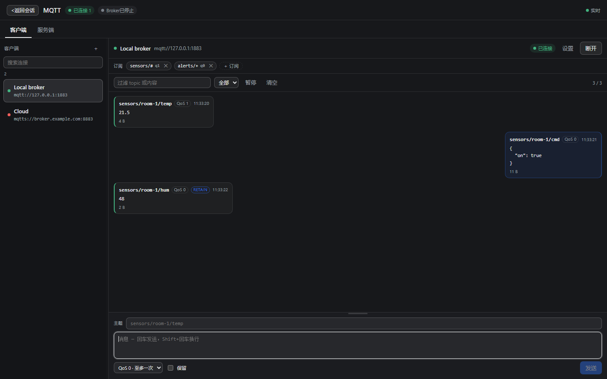
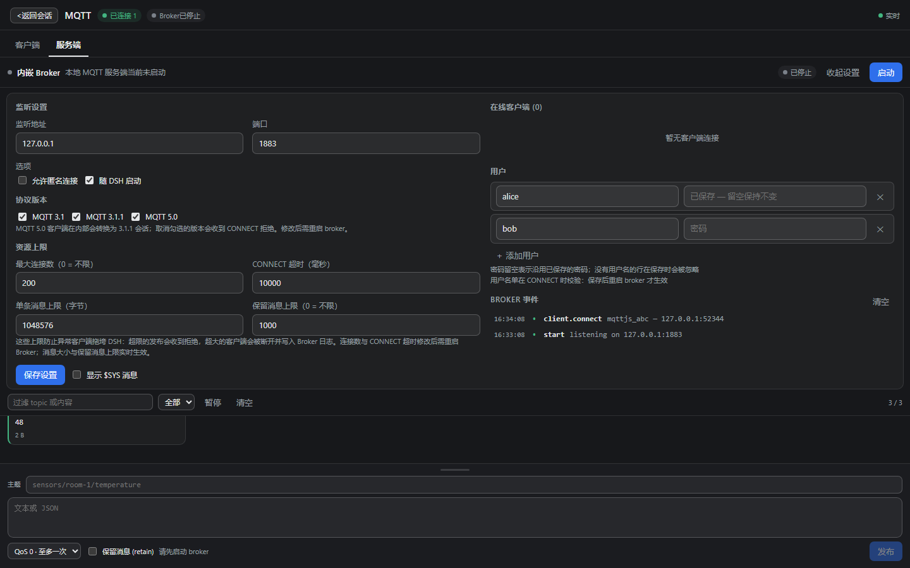
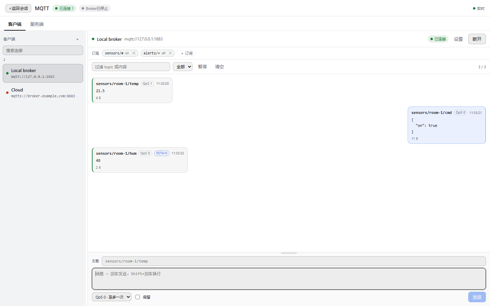

# dsh-mqtt-tools

[](https://github.com/GodLike2020/dsh-mqtt-tools/actions/workflows/ci.yml) [](https://www.npmjs.com/package/dsh-mqtt-tools) [](https://www.npmjs.com/package/dsh-mqtt-tools) [](https://github.com/deepseek-ai/deepseek-harness)

**[简体中文](README.md)** · [English](README.en.md)

给 [DeepSeek Harness](https://github.com/deepseek-ai/dsh) 用的 MQTT 客户端 **和** 内嵌 MQTT Broker，一个插件全搞定。

在侧边栏打开 **MQTT** 面板：连接 Broker（或在本机一键起一个），订阅、发布、实时看消息；同一套引擎还以九个 `mqtt_*` 工具的形式提供给所有智能体调用。



## 功能

- **一个面板，两个标签页**
  - **客户端**：管理连接、聊天式消息流、常驻的发布输入框。一块卡片：上面一行是主题，中间是消息框，右下角发送。回车发送，Shift+回车换行（中文输入法组字时的回车不会误发），主题为空时直接把焦点放到主题上。消息框随文字长高，也能拖动：拖它上方的把手（或聚焦后用 ↑/↓），本次会话内记住你选的高度。改了地址或账号后直接点「连接」即可——会先把这份草稿保存下来再拨号，收起设置也不会丢改动。连接失败或掉线后可以直接重试；在线时改了地址再保存，会先断开旧会话，不会出现「显示新地址、消息却还发往旧 Broker」。
  - **服务端**：内嵌 Broker、在线客户端、事件日志，底部是和客户端同款的发布卡片，设置区同样可以收起——运行中的 Broker 默认收起，把空间让给日志；点「启动」会先保存当前配置再启动。消息框同样可以拖高：拖它上方的把手（或聚焦后用 ↑/↓），发长 payload 时不用挤着看。保留消息会随配置一起保存，重启 Broker 后自动重放；抽屉里显示当前保留了多少条，可以一键清除。
- **正经的 MQTT 客户端**：连接配置（URL、clientId、账号密码、keepalive、clean
  session、重连间隔、协议 3.1 / 3.1.1 / 5.0），按 QoS 订阅/退订，QoS 0–2 发布、
  retain、通配符、保留消息、断线重连。
- **内嵌 Broker**：面板里直接启动；可设 host/端口、匿名访问或用户表、随 DSH
  自启动；支持 3.1 / 3.1.1 / 5.0、保留消息、持久会话、`$SYS` 开关、每个客户端的
  订阅列表、事件日志。
- **消息日志**：方向箭头、主题、内容（UTF-8 或 base64）、QoS、retain、时间戳、
  分页（最新 100 条起）、过滤、暂停。
- **智能体工具**：面板用的同一套引擎，智能体可直接调用 `mqtt_list`、
  `mqtt_connect`、`mqtt_disconnect`、`mqtt_subscribe`、`mqtt_unsubscribe`、
  `mqtt_publish`、`mqtt_messages`、`mqtt_wait`、`mqtt_broker`。
- **亮色/暗色主题**：界面底色由当前文字色推导，单色主题下也看得清。

| 服务端 | 客户端（浅色） |
| --- | --- |
|  |  |

## 安装

插件是 DSH Bundle：`package.json` 里带 `dsh.bundle.patch`，由服务端一半
（`index.js` + `lib/`）和浏览器一半（`client.js`）组成。已经发布到 npm：
[`dsh-mqtt-tools`](https://www.npmjs.com/package/dsh-mqtt-tools)。

### 从 npm 安装（推荐）

```powershell
# 1. 让 DSH 从 npm 装上这个包（plugin_manager → install_bundle → target: dsh-mqtt-tools）
plugin_manager install_bundle { "target": "dsh-mqtt-tools" }

# 2. DSH 列出 “MQTT 工具” 后启用它
```

### 从源码安装

```powershell
git clone https://github.com/GodLike2020/dsh-mqtt-tools.git
cd dsh-mqtt-tools
npm install
# 然后：设置 → 插件 → 安装 Bundle → 目标：本目录
# （或 plugin_manager → install_bundle → target: 绝对路径）
```

如果习惯自己管理 profile 依赖，也可以用 `dsh plugin add dsh-mqtt-tools`。

装完重载一次 DSH，侧边栏出现 **MQTT**。不需要任何配置，面板初始为空。

> 插件不会手改你 profile 的 `package.json` / `cordis.patch.yml`：Bundle 的安装和
> patch 都走 DSH 自己的安装器。

## 怎么用

1. **客户端 → 新建连接**：填名字和 URL，例如 `mqtt://127.0.0.1:1883`、
   `mqtts://broker.example.com:8883`（TLS 用 Node 默认证书链；自签 Broker 可在该
   连接里关掉 `rejectUnauthorized`），再按需填账号密码、clientId、keepalive、
   协议版本。
2. **连接**，然后添加订阅（`sensors/+/temperature`、`#` 等）。
3. 在底部常驻输入框里填主题和内容，回车发送——消息在输入框上方滚动，最新在下。
4. **服务端 → 启动**，起一个本机 MQTT 服务，其他设备/客户端连
   `mqtt://<本机>:1883`。若关掉匿名访问，在同一页签添加用户，并在连接表单填账号。

窗口宽度可拖动调整（连接列表与消息区之间的分隔条）；每个连接的设置区可收起，
给消息区让位置。

## 智能体工具

工具和面板共用同一套引擎：在界面里配好的连接，智能体立刻能用；智能体建的连接，
界面里也能看到。

| 工具 | 作用 |
| --- | --- |
| `mqtt_list` | 列出连接（id、名字、URL、状态、订阅）和 Broker 状态。 |
| `mqtt_connect` | 按 id/名字连接已保存的连接，或直接用 `url` 新建并连接。 |
| `mqtt_disconnect` | 断开连接。 |
| `mqtt_subscribe` | 按 QoS 订阅主题（持久保存）。 |
| `mqtt_unsubscribe` | 退订。 |
| `mqtt_publish` | 通过某个连接或内嵌 Broker 发布。 |
| `mqtt_messages` | 读最近消息，可按连接/来源/方向/主题过滤。 |
| `mqtt_wait` | 等待匹配的消息（类似 `mosquitto_sub`），带回溯窗口。 |
| `mqtt_broker` | 查看/启动/停止/保存内嵌 Broker。 |

典型智能体流程：

```text
mqtt_broker start
mqtt_connect url=mqtt://127.0.0.1:1883 name=local
mqtt_subscribe connection=local topic="sensors/#" qos=1
mqtt_wait    connection=local topic="sensors/#" timeoutMs=10000
mqtt_publish via=client connection=local topic="devices/lamp/set" payload="on" qos=1
```

内容能按 UTF-8 解码就返回文本，否则返回 base64；`mqtt_publish` 传
`encoding: "base64"` 可发送二进制。

## HTTP API

面板没有特权，它和任何本机工具用的是同一个 API。

| 方法 | 路径 | 作用 |
| --- | --- | --- |
| `GET` | `/dsh-mqtt-tools/api/state` | 当前状态（连接、Broker、工具、状态文件）+ 最近消息/事件。 |
| `POST` | `/dsh-mqtt-tools/api/command` | 单条命令：`client.*`、`broker.*`、`settings.save`、`log.clear`。 |
| `GET` | `/dsh-mqtt-tools/api/events` | SSE：`state`、`message`、`broker-event`、`cleared`。 |

`POST` 需要 `x-dsh-mqtt-tools: 1` 请求头和同源校验；密码只写不读
（返回 `hasPassword`，永远不返回值）。

## 协议版本

- **MQTT 3.1.1** — 内嵌 Broker（`aedes`）的原生协议。
- **MQTT 3.1** — 接受，按 3.1 帧解析。
- **MQTT 5.0** — 同一端口接受。通过一层转换把 MQTT 5 会话译成 3.1.1 交给
  Broker，再把回复编码回 MQTT 5，因此 MQTT 5 客户端能连接、订阅、发布、用 QoS
  1/2、保留消息和持久会话。MQTT 5 独有的能力（属性、共享订阅、主题别名、流控）
  不宣告、也不实现——从客户端视角看它就是一个 3.1.1 Broker。
  订阅选项里的 `noLocal`、`retainHandling` 会被接受但忽略：客户端可能收到自己
  发布的消息，且每次匹配订阅都会收到保留消息。

每个版本都可以在“服务端”页签关掉；关掉的版本会被正常 CONNACK 拒绝
（MQTT 5 为 `0x84`，3.1/3.1.1 为 return code 1），并写进 Broker 事件日志。

### 资源上限

内嵌 Broker 会限制异常客户端，避免拖垮 DSH 进程：

| 设置 | 默认值 | 作用 |
| --- | --- | --- |
| `maxConnections` | `200`（0 = 不限） | 超出的 TCP 连接一到就被关闭，并写 Broker 事件日志。 |
| `connectTimeoutMs` | `10000` | 连上后在时限内没发 CONNECT 的 socket 会被关闭并记录原因。 |
| `maxPayloadBytes` | `1048576`（1 MiB） | 更大的客户端 PUBLISH（含遗嘱）会断开该客户端；面板发布框和 `mqtt_publish` 会得到普通错误提示，不会断连。 |
| `maxRetainedMessages` | `1000`（0 = 不限） | 超出上限的保留消息发布会被拒绝；用空 payload 清除一条保留消息即可腾出名额。 |

这些值和其他 Broker 设置一起存盘，可以在“服务端”页签的「资源上限」里直接修改，
也可通过 `mqtt_broker save` 工具或 `POST /dsh-mqtt-tools/api/command` 修改：

```jsonc
{ "cmd": "broker.save", "broker": { "maxPayloadBytes": 262144, "maxRetainedMessages": 200 } }
```

监听相关设置改完需重启 Broker 生效；payload/保留消息预算实时生效。

## 状态文件

`$DSH_HOME/dsh-mqtt-tools.json`（默认 `~/.dsh/dsh-mqtt-tools.json`）：连接配置
（含密码，权限即你的系统账号权限）、Broker 设置、`$SYS` 开关。从 0.2.x 升级会
自动接管旧的 `dsh-mqtt.json`。

## 测试

仓库自带测试套件（仅开发用，不随 npm 包发布）：

```powershell
node scripts/suite/run-all.mjs              # 全部套件，串行
node scripts/suite/run-all.mjs protocol     # 按名字过滤
node scripts/suite/ui.test.mjs              # 单跑一个
```

| 套件 | 覆盖 |
| --- | --- |
| `protocol` | MQTT 3.1/3.1.1/5.0、遗嘱、持久会话、保留消息、通配符、QoS、畸形输入、版本开关。 |
| `interop` | 外部客户端连我们的 Broker；我们的客户端连公共 Broker。 |
| `api-tools` | HTTP 契约、CSRF/同源/限额、安全泄漏、九个工具端到端。 |
| `ui` | 所有面板状态的 SSR、jsdom 交互、中英文案一致性、对比度审计。 |
| `lifecycle` | SSE/hub 泄漏、状态持久化、端口冲突、重启/dispose、重连。 |
| `perf` | 吞吐、环形日志上限、大 payload、连接风暴、SSE 扇出。 |
| `hardening` | payload 预览在进入环形日志前就被截断；SSE 背压会把停止读取的页面丢弃，而不是无限缓冲。 |
| `resilience` | start/stop 竞态、可等待的 dispose（端口确实释放）、CONNECT 超时、连接/payload/保留消息上限、上限持久化。 |

套件用临时 `DSH_HOME` 和随机端口自我隔离；live 套件需要 DSH GUI 在跑，用
`DSH_BASE` 指定（如 `$env:DSH_BASE="http://127.0.0.1:10570"`）。

## 说明

- 内嵌 Broker 目前只有明文 MQTT over TCP，没有 WebSocket/TLS 监听。要暴露到局域网
  请自己决定并放行防火墙端口。
- 不装 DSH GUI 也能截图看面板：`node scripts/preview-shot.mjs dark`（仅开发用，
  `npm install` 会装好开发依赖；本地用 `.testtools/` 装也一样）。
- `$SYS/broker/...` 默认不进消息日志，服务端页签里有开关。
- 支持中英文，跟随 Harness 语言。

## 许可证

MIT — 见 [LICENSE](LICENSE)。
