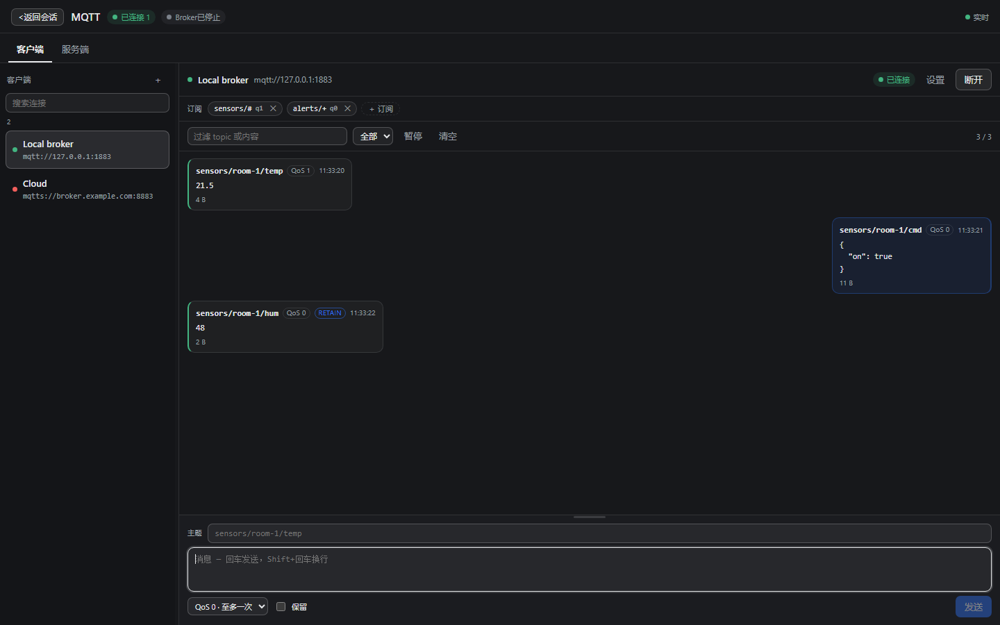

# dsh-mqtt-tools 0.3.11

MQTT client **and** an embedded MQTT broker for
[DeepSeek Harness](https://github.com/deepseek-ai/dsh), in one plugin bundle:
a panel in the sidebar plus nine `mqtt_*` tools for every agent in the harness.



## What you get

- **One panel, two tabs** — saved connections on one side, an embedded broker on
  the other, with the same chat-style send card at the bottom of both.
- **Real MQTT client** — reconnect, clean sessions, keepalive, client ids,
  credentials, protocol 3.1 / 3.1.1 / 5.0, subscribe/unsubscribe with QoS,
  publish with QoS 0–2 and retain, wildcard topics, TLS (wss) URLs accepted by
  the underlying `mqtt` driver.
- **Message log** — topic / payload / source filter, direction filter, pause
  with an unread count, 100-row windows, one-click scoped clearing.
- **Embedded broker** — [aedes](https://github.com/moscajs/aedes) on plain TCP,
  protocol-version gating, anonymous access or a username/password list checked
  on CONNECT, connection / payload / retained limits, a live client table and
  event log. Retained messages are saved with the configuration and replayed
  after a restart; the drawer shows how many topics retain a value and clears
  them in one click.
- **Panel ergonomics** — foldable settings drawers (a running broker starts
  folded), save-before-connect and save-before-start, drafts and log filters
  that survive tab switches, a message box that grows with the text and can be
  dragged taller, IME-safe Enter, and localized (English / Chinese) panel text.
- **Agent tools** — `mqtt_list`, `mqtt_connect`, `mqtt_disconnect`,
  `mqtt_subscribe`, `mqtt_unsubscribe`, `mqtt_publish`, `mqtt_messages`,
  `mqtt_wait`, `mqtt_broker`.

## Install

Requires Node.js >= 20 and a DeepSeek Harness build with plugin bundles.

```text
plugin_manager list_bundles                      # confirm the bundle is installed
plugin_manager install_bundle { "target": "dsh-mqtt-tools" }   # from npm
plugin_manager install_bundle { "target": "<path to this folder>" }  # from a checkout
```

Enable **MQTT Tools**, then open the **MQTT** panel in the sidebar. The fault
messages the host returns are restated in the panel language, and the raw text
stays in the tooltip.

## Testing

The repository ships its test suites:

```bash
npm install
npm run test:offline     # protocol 31 / lifecycle 35 / perf 9 / ui 43
```

`test:offline` needs no DSH GUI: it runs real brokers and clients on isolated
ports with temporary state files. As of this release: **118 passed, 0 failed,
1 skipped** (the skipped check needs a token-authenticated live GUI).

## Changes in 0.3.11

- The broker's send card got the resize grip back: drag it (or focus it and use
  the arrow keys) to size the message box; the log keeps its floor and the card
  never spills out of the pane. A hand-picked height survives sends and tab
  switches.
- Bilingual release notes, GitHub Actions CI, and `npm install` now brings the
  dev dependencies the test suites need.

See [CHANGELOG.md](../CHANGELOG.md) for the complete history.

## License

MIT — see [LICENSE](../LICENSE).

---

# dsh-mqtt-tools 0.3.11（中文）

一个 DeepSeek Harness 插件：侧边栏里的 **MQTT 面板**（客户端 + 内嵌 Broker），
同时给 Harness 里每个 Agent 提供九个 `mqtt_*` 工具。


**能做什么**

- 一个面板两个标签页：连接管理和内嵌 Broker，底部是同一款发布卡片。
- 正经的 MQTT 客户端：多连接配置（URL、clientId、账号密码、keepalive、
  clean session、重连间隔、协议 3.1 / 3.1.1 / 5.0），按 QoS 订阅/退订，
  QoS 0–2 发布、retain、通配符，消息日志支持过滤、方向、暂停和分页。
- 内嵌 Broker：TCP 监听、协议版本校验、匿名或用户名/密码（CONNECT 时校验）、
  连接数/载荷/保留消息上限、在线客户端表格和事件日志；保留消息随配置保存，
  重启后自动重放，抽屉里能看数量并一键清除。
- 面板细节：设置可收起（运行中的 Broker 默认收起）、点连接先存草稿再拨号、
  点启动先保存再启动、草稿和日志筛选跨标签页保留、消息框可拖动调高、
  输入法回车不误发、中英文界面。
- 智能体工具：`mqtt_list`、`mqtt_connect`、`mqtt_disconnect`、
  `mqtt_subscribe`、`mqtt_unsubscribe`、`mqtt_publish`、`mqtt_messages`、
  `mqtt_wait`、`mqtt_broker`。

**安装**：需要 Node.js >= 20 和支持插件 bundle 的 DeepSeek Harness。用
`plugin_manager install_bundle` 装（npm 包名 `dsh-mqtt-tools`，或指向本目录的
绝对路径），启用 **MQTT 工具** 后从侧边栏打开 **MQTT** 面板。

**测试**：`npm install && npm run test:offline`，离线跑真实 Broker/客户端，
本版本为 **118 passed / 0 failed / 1 skipped**。

**0.3.11 变化**：服务端发布卡找回可拖动的高度调节（也支持 ↑/↓），手动拖过的
高度在发送和切换标签页后保留；补了 GitHub Actions CI，`npm install` 会装好
测试所需的开发依赖。

完整历史见 [CHANGELOG.md](../CHANGELOG.md)，许可证 MIT。
